

# Nexa · Disruptive Architectures: IoT, IoB & Generative IA

Entrega da disciplina **Disruptive Architectures: IoT, IoB & Generative IA** — Global Solution 2026/2 (FIAP, 2º ano ADS), tema CitizenTech.

> 📄 Documentação técnica completa, em norma ABNT: [`documentacao-tecnica.pdf`](documentacao-tecnica.pdf).

## O problema e a proposta

O **Nexa** é um aplicativo que ajuda o cidadão a comparar unidades de saúde antes de se deslocar — distância, situação da fila e faixa estimada de espera por serviço. Este repositório cobre a ponta física dessa solução: o **totem de check-in**.

Ao chegar na unidade, o cidadão digita o próprio CPF no totem, escolhe o tipo de atendimento (clínico geral, triagem, vacinação, pediatria ou odontologia) e recebe uma senha na hora. O totem não inventa nada sozinho: ele confirma com a API do backend (Java) que aquele paciente existe, registra a chegada na fila daquela unidade e mostra no display exatamente a senha e a posição que o backend devolveu.

Optou-se por um totem físico, e não só pelo aplicativo, porque nem todo cidadão chega à unidade já com o app aberto, e a recepção também precisa de um jeito confiável e padronizado de registrar quem chegou. O totem resolve isso: qualquer pessoa, mesmo sem usar o aplicativo antes, consegue se registrar na fila sozinha, só digitando o CPF.

## Telas do aplicativo Nexa

O totem é a ponta física da solução; o aplicativo Nexa é a ponta digital, que o cidadão usa antes de sair de casa para comparar as unidades. As telas abaixo são do app Flutter ([`fe-nexa-app`](https://github.com/NexaGS/fe-nexa-app)), na ordem em que o cidadão as vê.

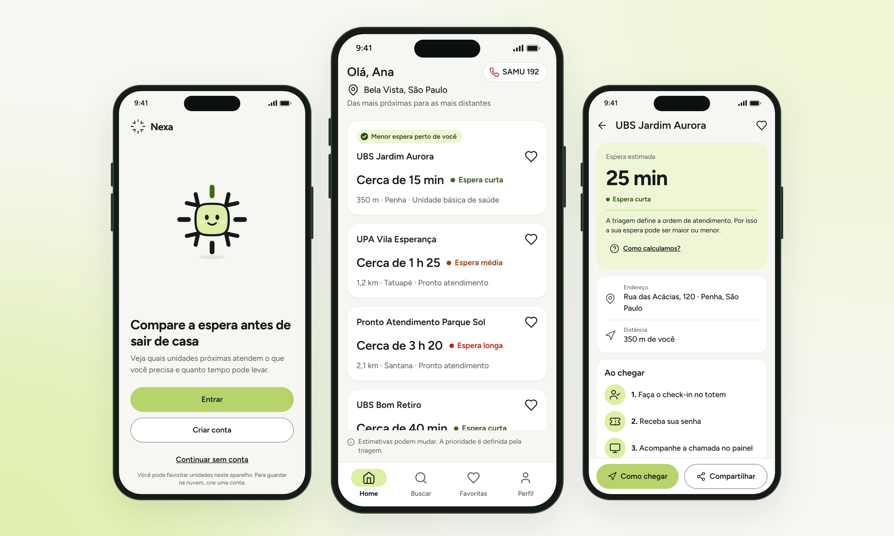

<table>
<tr>
<td align="center" width="33%">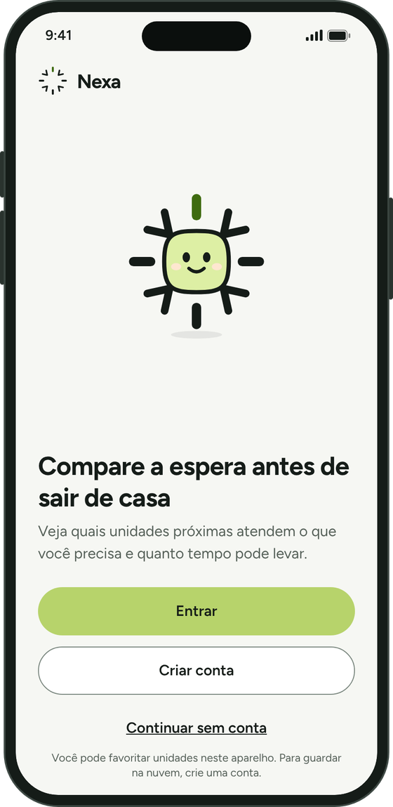 <b>1. Boas-vindas</b> Entrar, criar conta ou continuar sem conta</td>
<td align="center" width="33%">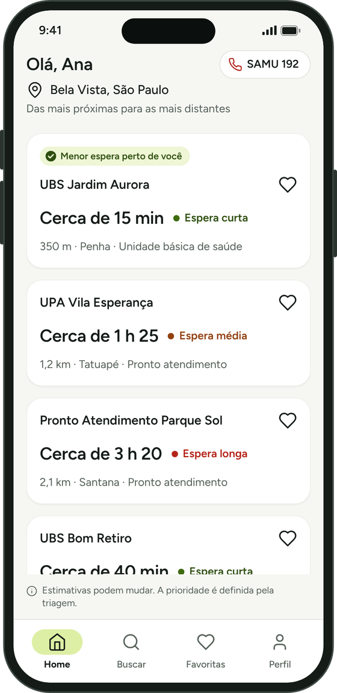 <b>2. Início</b> Unidades das mais próximas às mais distantes, com a faixa de espera</td>
<td align="center" width="33%"> <b>3. Buscar</b> Busca por nome e filtro por estado</td>
</tr>
<tr>
<td align="center" width="33%">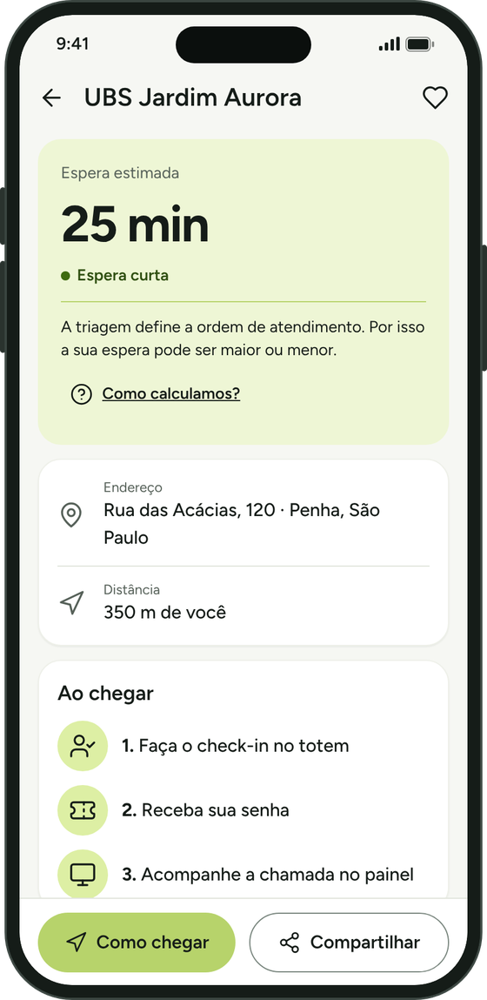 <b>4. Detalhe da unidade</b> Espera estimada, endereço, distância e orientações de chegada</td>
<td align="center" width="33%"> <b>5. Como calculamos a espera</b> Explicação da faixa de espera</td>
<td align="center" width="33%"> <b>6. Favoritas</b> Unidades salvas e a de menor espera</td>
</tr>
<tr>
<td align="center" width="33%"> <b>7. Entrar</b> Login por e-mail e senha, com erro de validação</td>
<td align="center" width="33%"> <b>8. Criar conta</b> Cadastro com validação dos campos</td>
<td align="center" width="33%">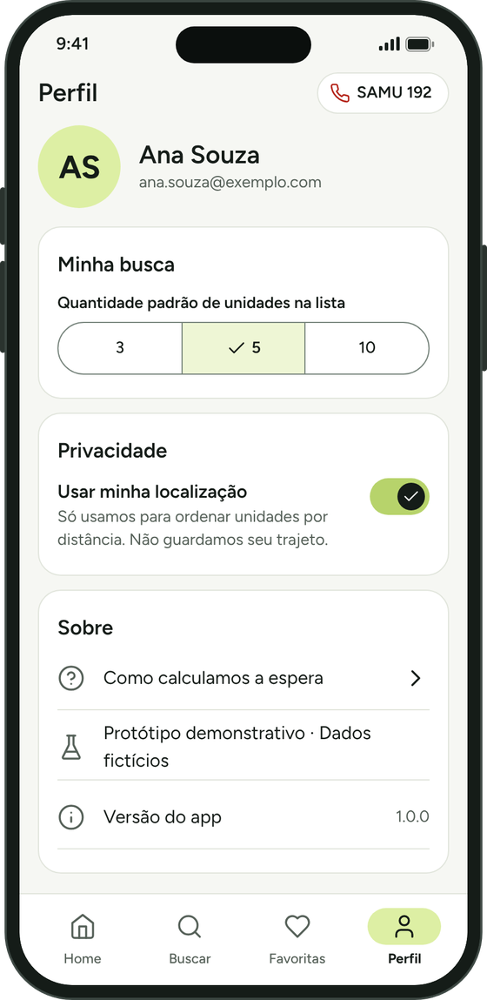 <b>9. Perfil</b> Preferências, privacidade de localização e sobre o protótipo</td>
</tr>
</table>

Telas renderizadas a partir do código do app, com dados fictícios.

## Protótipo

Simulado no Wokwi com **ESP32-S3-DevKitC-1**: **[wokwi.com/projects/480148232017959937](https://wokwi.com/projects/480148232017959937)**

**Como rodar:**
1. Abrir o link do Wokwi acima
2. Clicar no botão ▶ (play) para iniciar a simulação e aguardar a conexão de WiFi (aparece "WiFi conectado!" no Serial Monitor)
3. No teclado desenhado no circuito, digitar os 11 dígitos de um CPF já cadastrado na base e apertar **#** para confirmar
4. Escolher o tipo de atendimento no menu que aparece no display (teclas 1 a 5)
5. Conferir a senha exibida no display (SSD1306) e a resposta completa da API no Serial Monitor

O mesmo circuito e firmware estão espelhados neste repositório, para quem não quiser depender do link externo:

- [`nexa/nexa.ino`](nexa/nexa.ino) — código-fonte
- [`nexa/libraries.txt`](nexa/libraries.txt) — dependências (Adafruit GFX Library, Adafruit SSD1306, ArduinoJson, Keypad)
- [`nexa/secrets.h.example`](nexa/secrets.h.example) — modelo de configuração (Wi-Fi, endpoint do servidor e ID da unidade); copie para `secrets.h` e preencha antes de compilar — esse arquivo está no `.gitignore` para não versionar credenciais daqui em diante (os valores hoje em `nexa/secrets.h` são só placeholders, sem segredo real)
- [`circuito/diagram.json`](circuito/diagram.json) — circuito, importável direto num novo projeto Wokwi

> A pasta se chama `nexa/` (e não `firmware/`) porque o Arduino IDE exige que a pasta do sketch tenha o mesmo nome do arquivo `.ino` principal — é só essa regra, não afeta como o projeto é editado no VS Code ou simulado no Wokwi.

## Componentes

| Componente | Função | Origem |
|---|---|---|
| ESP32-S3-DevKitC-1 | Processamento e Wi-Fi | Já em posse da equipe |
| Teclado matricial 4x4 | Entrada do CPF e escolha do tipo de atendimento | Protótipo físico: teclado de membrana padrão, já em posse da equipe |
| Display OLED SSD1306, 0.96", I2C 128x64 | Mostra o CPF digitado, o menu de atendimento, a senha e as mensagens de erro | A comprar para o protótipo físico |
| Buzzer | Confirmação sonora a cada tecla e ao emitir a senha | Já em posse da equipe |
| LED | Indicador de totem ligado/pronto | Já em posse da equipe |
| Resistor 220Ω | Limita a corrente do LED | A ter no kit |
| Bateria LiPo + módulo de carga (TP4056) | Opcional — totem funciona mesmo sem energia da concessionária | Protótipo físico, não simulável no Wokwi |

A simulação digital não depende de nenhuma compra: todos os componentes acima existem como partes no Wokwi. O protótipo físico é um incremento sobre a mesma lógica, não um projeto separado.

## Mapa de pinos

| Pino (ESP32-S3) | Componente | Por quê |
|---|---|---|
| GPIO4, 5, 6, 16 | Linhas do teclado matricial | Fora da faixa de strapping pins (0, 3, 45, 46) |
| GPIO17, 18, 21, 35 | Colunas do teclado matricial | Idem |
| GPIO7 | Buzzer | Suporta PWM, necessário para `tone()` |
| GPIO15 | LED de status | Pino livre, sem conflito com boot ou I2C |
| GPIO8 (SDA) / GPIO9 (SCL) | Display OLED | Pinos padrão do barramento I2C na ESP32-S3-DevKitC-1 |

O LED precisa do resistor de 220Ω porque ele puxa corrente de verdade quando aceso — sem limitar, estressaria o pino e o próprio LED.

[Fonte editável deste diagrama](diagramas/circuito-pinos.mmd)

## Arquitetura e fluxo de comunicação em rede

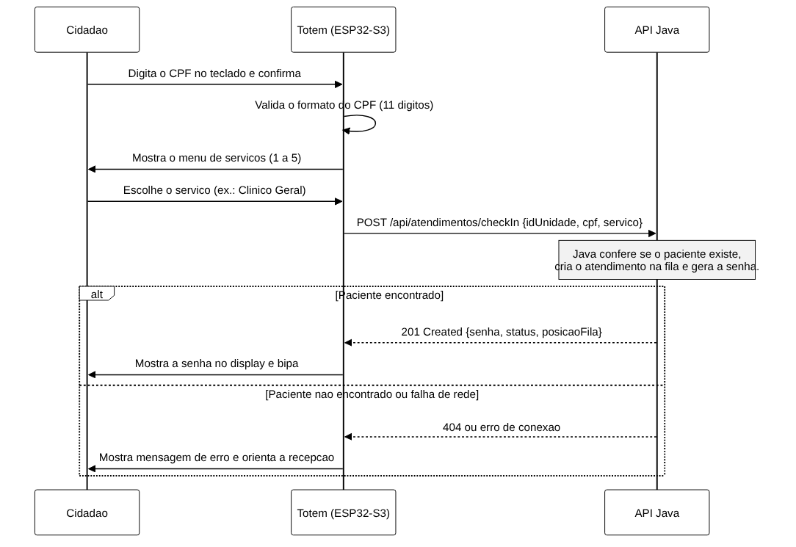

[Fonte editável deste diagrama](diagramas/fluxo-comunicacao-totem.mmd)

**A senha mostrada no totem é a senha real, devolvida pela API Java na hora:**

- O cidadão digita o CPF e escolhe o tipo de atendimento diretamente no totem.
- O totem faz uma chamada HTTPS síncrona para a API (`POST /api/atendimentos/checkIn`), informando a unidade, o CPF e o serviço escolhido.
- O Java confere se aquele CPF já está cadastrado, cria o atendimento na fila daquela unidade/serviço e devolve a senha, o status (chamado na hora ou aguardando) e a posição na fila.
- O totem só mostra a senha depois que o Java confirma — não existe senha "local" desencontrada da fila real.

O totem não declara a própria unidade por engano: o ID da unidade vem de uma configuração do dispositivo, e é o servidor quem valida e mantém a fila daquela unidade. Isso permite realocar um totem físico para outra unidade só trocando essa configuração, sem reescrever a lógica do firmware.

O totem se conecta direto por Wi-Fi (o ESP32-S3 tem rádio próprio), sem precisar de um computador fazendo ponte serial — essa é uma simplificação deliberada em relação a abordagens com Arduino sem Wi-Fi integrado, que dependeriam de uma ponte USB local.

### Fluxo de erros

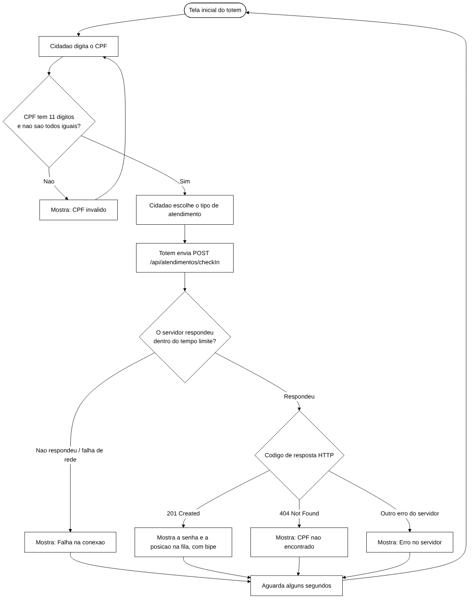

[Fonte editável deste diagrama](diagramas/fluxograma-erros.mmd)

O firmware trata explicitamente quatro desvios, a partir do momento em que o cidadão começa a digitar o CPF:

1. **CPF em formato inválido** — o totem confere, antes de enviar qualquer coisa ao servidor, se o CPF tem 11 dígitos e não são todos iguais; se a verificação falhar, mostra "CPF inválido" e não gasta uma chamada de rede.
2. **CPF não encontrado (HTTP 404)** — o CPF é válido no formato, mas não está cadastrado na base; o totem mostra "CPF não encontrado".
3. **Erro no servidor (demais códigos HTTP de erro)** — qualquer outro erro do lado da API é tratado de forma genérica, com a mensagem "Erro no servidor".
4. **Falha de conexão** — se a rede cair, o túnel ficar fora do ar ou o tempo de resposta se esgotar, o totem mostra "Falha na conexão".

Em todos os casos — inclusive no de sucesso — o totem volta sozinho para a tela inicial depois de alguns segundos, pronto para o próximo cidadão.

## Estado atual do firmware

O [`nexa/nexa.ino`](nexa/nexa.ino) já implementa o fluxo completo do totem, de ponta a ponta:

1. Conecta ao Wi-Fi ao ligar, com reconexão automática se a conexão cair
2. Recebe o CPF dígito a dígito pelo teclado, com opção de apagar (`*`) e confirmar (`#`)
3. Valida o formato do CPF (11 dígitos, não todos iguais) antes de prosseguir
4. Mostra o menu de atendimento e aceita a escolha do serviço
5. Envia o check-in para a API Java (via HTTPS, inclusive através de um túnel público quando simulado no Wokwi) e aguarda a resposta
6. Exibe a senha e a posição na fila devolvidas pelo Java, com aviso sonoro — ou uma das mensagens de erro específicas (CPF inválido, CPF não encontrado, erro no servidor, falha de conexão) quando algo não sai como esperado
7. Depois de alguns segundos, volta sozinho para a tela inicial, pronto para o próximo cidadão

## Evidências

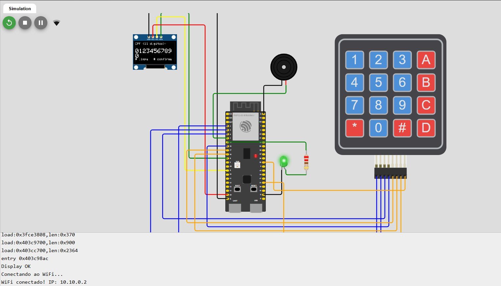

*Cidadão digitando o CPF no teclado matricial — o display mostra os dígitos em tempo real e o rodapé lembra os comandos (`*` limpa, `#` confirma).*

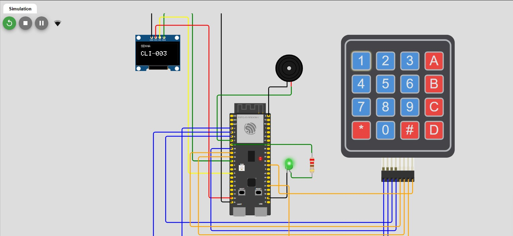

*Check-in concluído com sucesso: o display mostra `SENHA: CLI-003`, devolvida pela API Java.*

*O mesmo check-in, visto pelo Serial Monitor: o JSON completo devolvido pela API — paciente, status `AGUARDANDO`, serviço `CLINICO_GERAL` e posição na fila.*

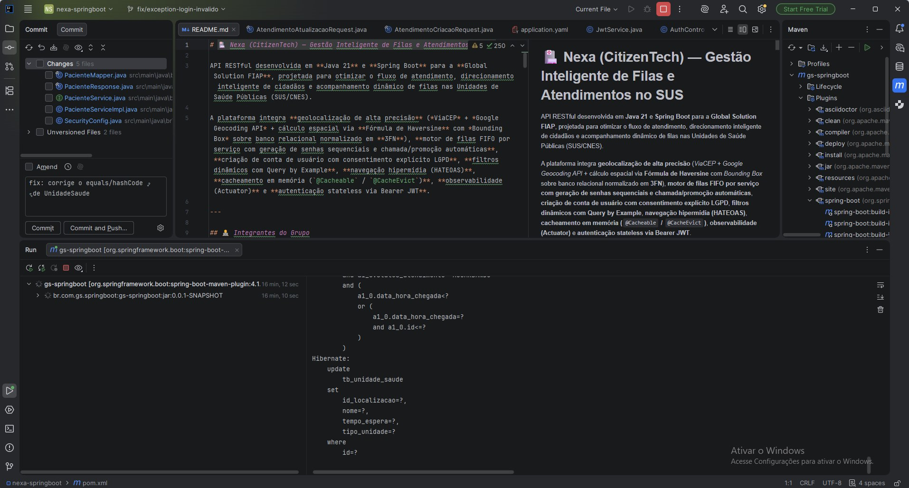

*Do outro lado do túnel: a aplicação Spring Boot recebendo a chamada do totem e atualizando a fila real no banco de dados para decidir a senha e a posição do paciente.*

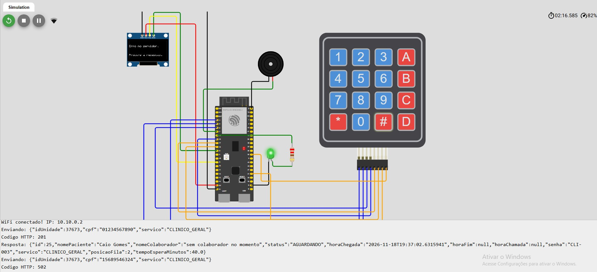

*Um segundo check-in, logo em seguida, recebeu um erro do lado da API (código HTTP de erro); o totem trata isso de forma genérica e mostra "Erro no servidor. Procure a recepção.", exatamente como descrito em "Fluxo de erros".*

Dos quatro desvios descritos em "Fluxo de erros", dois já foram exercitados com print contra o ambiente real: o caminho de sucesso e o de erro no servidor, acima. Os outros dois (CPF não cadastrado e falha de conexão) seguem implementados no firmware e validados por leitura de código; prints desses dois são adicionados aqui assim que uma nova sessão de testes for realizada.

## Limitações

- Sem impressão física de papel — a senha é só exibida no display, decisão para manter o totem simples e com menos pontos de falha (sem dependência de rolo de papel).
- O teclado matricial não tem teclas suficientes para digitar nome e letras, então o totem pressupõe que o cidadão já tem um cadastro prévio (CPF) na base; ele não faz auto-cadastro na hora.
- O protótipo físico (hardware real) depende da compra do display OLED; a simulação no Wokwi cobre os requisitos de circuito, firmware e evidências independentemente dessa compra.

## Identificação dos integrantes

| Nome completo | RM | Turma |
|---|---|---|
| Paulo Cavalcante Caroba | RM566667 | 2TDSPS |
| Renan da Silva Paulino | RM566610 | 2TDSPS |
| Sergio Henrique da Silva Santos | RM567254 | 2TDSPS |

