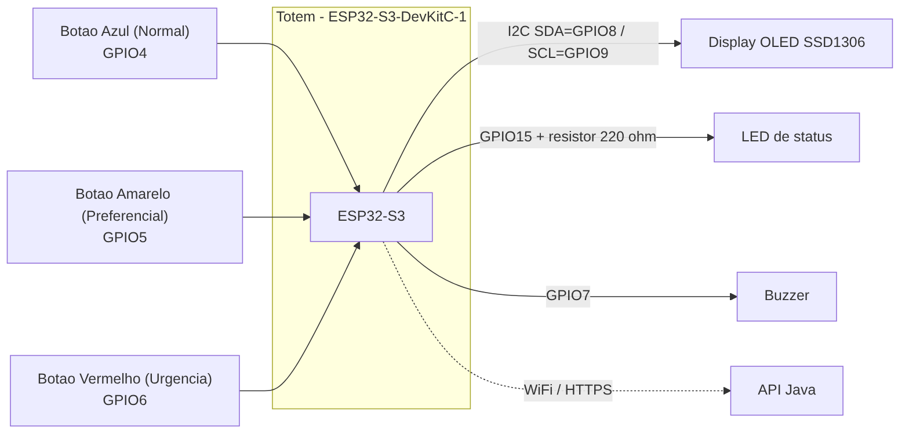
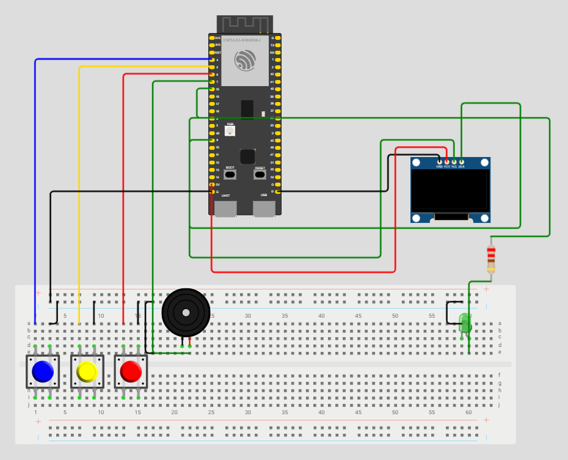

# Nexa · Disruptive Architectures: IoT, IoB & Generative IA

Entrega da disciplina **Disruptive Architectures: IoT, IoB & Generative IA** — Global Solution 2026/2 (FIAP, 2º ano ADS), tema CitizenTech.

## O problema e a proposta

O **Nexa** é um aplicativo que ajuda o cidadão a comparar unidades de saúde antes de se deslocar — distância, situação da fila e faixa estimada de espera por serviço. Este repositório cobre a ponta física dessa solução: o **totem de check-in**.

Ao chegar na unidade, o cidadão usa o totem para declarar o tipo de atendimento (normal, preferencial ou urgência) e recebe uma senha. O totem não decide nada sozinho — ele só registra o evento; quem gera a senha, mantém a fila e calcula a estimativa é a API do backend (Java). A ideia é que o totem funcione com o mínimo possível de infraestrutura própria: sem impressão de papel, com possibilidade de operar por bateria quando a energia da concessionária falhar, sem competir por carga com os equipamentos realmente críticos do hospital.

## Protótipo

Simulado no Wokwi com **ESP32-S3-DevKitC-1**: **[wokwi.com/projects/480148232017959937](https://wokwi.com/projects/480148232017959937)**

**Como rodar:**
1. Abrir o link do Wokwi acima
2. Clicar no botão ▶ (play) para iniciar a simulação
3. Abrir o Serial Monitor (ícone no rodapé do editor)
4. Clicar nos botões azul, amarelo ou vermelho desenhados no circuito
5. Conferir a senha no display (SSD1306) e o log técnico no Serial Monitor

O mesmo circuito e firmware estão espelhados neste repositório, para quem não quiser depender do link externo:

- [`firmware/nexa.ino`](firmware/nexa.ino) — código-fonte
- [`firmware/libraries.txt`](firmware/libraries.txt) — dependências (Adafruit GFX Library, Adafruit SSD1306)
- [`circuito/diagram.json`](circuito/diagram.json) — circuito, importável direto num novo projeto Wokwi

## Componentes

| Componente | Função | Origem |
|---|---|---|
| ESP32-S3-DevKitC-1 | Processamento e Wi-Fi | Já em posse da equipe |
| 3x botão (azul, amarelo, vermelho) | Tipo de atendimento: normal, preferencial, urgência | Protótipo físico: trocar os táteis pequenos por botão tipo arcade 12–16mm |
| Display OLED SSD1306, 0.96", I2C 128x64 | Mostra a senha e o estado do totem | A comprar para o protótipo físico |
| Buzzer | Confirmação sonora ao gerar a senha | Já em posse da equipe |
| LED | Indicador de totem ligado/pronto | Já em posse da equipe |
| Resistor 220Ω | Limita a corrente do LED | A ter no kit |
| Bateria LiPo + módulo de carga (TP4056) | Opcional — totem funciona mesmo sem energia da concessionária | Protótipo físico, não simulável no Wokwi |

A simulação digital não depende de nenhuma compra: todos os componentes acima existem como partes no Wokwi. O protótipo físico é um incremento sobre a mesma lógica, não um projeto separado.

## Mapa de pinos

| Pino (ESP32-S3) | Componente | Por quê |
|---|---|---|
| GPIO4 | Botão azul (normal) | GPIO de uso geral, fora da faixa de strapping pins (0, 3, 45, 46) |
| GPIO5 | Botão amarelo (preferencial) | Idem |
| GPIO6 | Botão vermelho (urgência) | Idem |
| GPIO7 | Buzzer | Suporta PWM, necessário para `tone()` |
| GPIO15 | LED de status | Pino livre, sem conflito com boot ou I2C |
| GPIO8 (SDA) / GPIO9 (SCL) | Display OLED | Pinos padrão do barramento I2C na ESP32-S3-DevKitC-1 |

Botões usam `INPUT_PULLUP` (resistor interno do próprio chip) e por isso dispensam resistor externo. O LED precisa do resistor de 220Ω porque, diferente do botão, ele puxa corrente de verdade quando aceso — sem limitar, estressaria o pino e o próprio LED.

[Fonte editável deste diagrama](diagramas/circuito-pinos.mmd)

## Arquitetura e fluxo de comunicação em rede

[Fonte editável deste diagrama](diagramas/fluxo-comunicacao-totem.mmd)

**A senha do totem e a fila do Java são duas coisas separadas, de propósito:**

- O totem gera a senha (N1, P1, U1...) **localmente**, na hora, sem esperar nenhuma resposta de rede. Essa senha é só a referência física do cidadão pra se situar na fila daquela unidade.
- O Java **não gera senha nenhuma**. Ele só recebe o aviso de que mais uma pessoa chegou (com o tipo de atendimento) e incrementa a contagem da fila daquela unidade/tipo — é essa contagem que alimenta a estimativa de espera mostrada no aplicativo.
- Os dois números não precisam bater. O totem não gerencia fila "por número", só entrega uma referência física ao cidadão; quem controla posição e estimativa pro app é o Java, por contagem.
- Isso também deixa o totem mais resiliente: a entrega da senha pro cidadão nunca depende da rede. Se o aviso pro Java atrasar ou falhar, o totem continua funcionando normalmente — só o dado do app que fica desatualizado até a próxima tentativa.

O totem também não declara a própria unidade — ele manda só o `deviceId`, e o servidor resolve a qual unidade aquele totem pertence. Isso permite realocar um totem físico para outra unidade só editando um cadastro administrativo, sem reflashar o firmware.

O totem se conecta direto por Wi-Fi (o ESP32-S3 tem rádio próprio), sem precisar de um computador fazendo ponte serial — essa é uma simplificação deliberada em relação a abordagens com Arduino sem Wi-Fi integrado, que dependeriam de uma ponte USB local.

## Estado atual do firmware

O [`firmware/nexa.ino`](firmware/nexa.ino) já implementa a parte definitiva da lógica do totem: lê os 3 botões, gera a senha local, mostra no display, bipa e volta ao estado de espera. Essa parte **não é um placeholder** — é como o totem deve se comportar mesmo depois de integrado ao Java, porque a senha é sempre local.

O que falta adicionar é só o aviso de rede pro Java, em paralelo, sem bloquear a exibição da senha:

1. Depois de mostrar a senha, o firmware faz um `POST /atendimentos {deviceId, tipoAtendimento}` — só pra incrementar a contagem da fila daquela unidade, sem esperar (nem precisar de) uma senha de volta na resposta
2. Conectar à rede Wi-Fi simulada do próprio Wokwi (`Wokwi-GUEST`, sem senha, com acesso real à internet) ou à rede real no protótipo físico
3. Se o envio falhar (sem Wi-Fi, servidor fora do ar), só registrar no Serial Monitor — isso nunca deve impedir o totem de continuar funcionando normalmente pro próximo cidadão
4. Reconectar ao Wi-Fi sozinho se a conexão cair no meio do uso

## Evidências

*Simulação no Wokwi em execução — Serial Monitor confirma a inicialização do display (`Display OK`) e o evento do botão azul gerando a senha `N1`.*

*Circuito completo: ESP32-S3-DevKitC-1, botões azul/amarelo/vermelho, buzzer, LED de status (aceso) e display OLED.*

## Limitações

- Sem impressão física de papel — a senha é só exibida no display, decisão para manter o totem simples e com menos pontos de falha (sem dependência de rolo de papel).
- A senha mostrada no totem é só a referência física local do cidadão; ela não precisa (e não deve) ser confundida com a posição controlada pelo Java, que trabalha por contagem, não por número de senha.
- O aviso de rede pro Java (incrementar a fila) ainda não está integrado ao firmware — só a geração local da senha está pronta e testada.
- A ordem de prioridade entre os tipos de atendimento é só um sinal enviado ao servidor — a triagem clínica da equipe sempre pode reordenar, o totem não decide atendimento.
- O protótipo físico (hardware real) depende da compra do display OLED; a simulação no Wokwi cobre os requisitos de circuito, firmware e evidências independentemente dessa compra.

## Identificação dos integrantes

| Nome completo | RM | Turma |
|---|---|---|
| Paulo Cavalcante Caroba | RM566667 | 2TDSPS |
| Renan da Silva Paulino | RM566610 | 2TDSPS |
| Sergio Henrique da Silva Santos | RM567254 | 2TDSPS |

## Conferência pela rubrica

| Critério de entrega | Pontos | Onde revisar |
|---|---:|---|
| Identificação do problema e proposta CitizenTech | 10 | Seção "O problema e a proposta" |
| Desenvolvimento do protótipo | 25 | Seção "Protótipo" e [`firmware/nexa.ino`](firmware/nexa.ino) |
| Identificação dos componentes e do fluxo de comunicação em rede | 20 | Seções "Componentes", "Mapa de pinos" e "Arquitetura e fluxo de comunicação em rede" |
| Diagrama da arquitetura | 15 | Diagrama de sequência acima |
| Testes, evidências e demonstração do protótipo | 20 | Seção "Evidências" |
| Documentação técnica e justificativa das escolhas | 10 | Seções "Mapa de pinos", "Estado atual do firmware" e "Limitações" |
